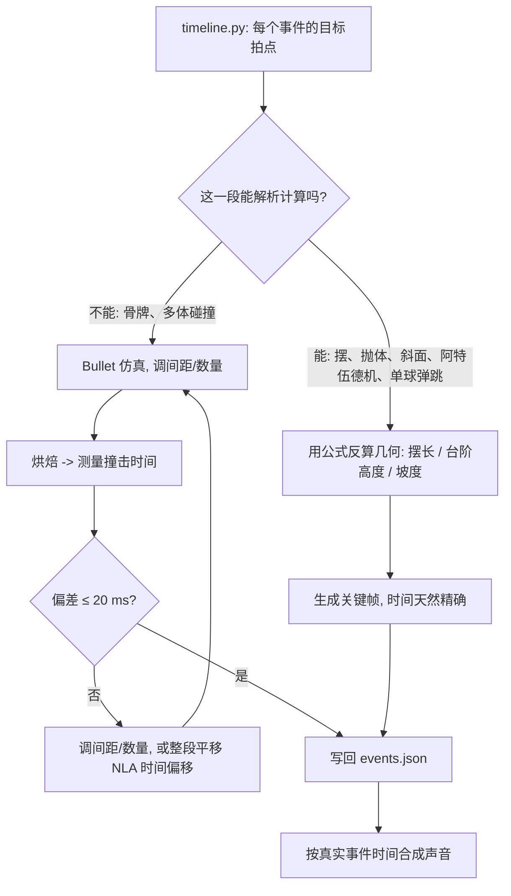

# 重力乐园 · 设计方案 v1（v0 设计 + 执行阶段的现实变更，见第 11 节）

> 状态：设计阶段，等待 J 确认后进入执行。
> 日期：2026-10-24（UTC+8）
> 本文所有物理参数为“设计目标值”，执行阶段会用仿真或解析计算逐项校核，并把实测结果回写到 `scripts/timeline.py` 和本文第 5 节。
> 标注约定：**【实测】** = 本次在 J 的 Mac 上实际跑出来的数据；**【估计】** = 推算或经验值，未验证；**【资料】** = 来自公开物理常识或文献。

---

## 0. 一句话概念

一台约 10 米长的“乐器作坊连锁机关”：一颗钢珠被节拍器放出，经过木、铜、玻璃、陶瓷、铸铁、弹簧钢等 17 个机关从左到右传递能量，每一次碰撞都是一个音符，全片 120 BPM、D 大调五声音阶，最后一锤敲响大铜钟，镜头拉开露出整台机器。

**所有声音都来自画面里的物体**（全片不加背景音乐），这是本片的核心卖点：观众听到的旋律就是他们看到的物理过程。

---

## 1. 观众体验曲线

### 1.1 设计原则（从观众第一感受出发）

| 观众本能 | 对应设计 |
|---|---|
| 想立刻知道“这是什么” | 第 1 秒就听到节拍器“嗒、嗒、嗒、嗒”，2 秒处钢珠被放出，钩子在 2 秒内完成 |
| 想看懂因果 | 每一个机关在被触发之前，已经在画面里“等着”（镜头提前半拍到一拍到达），观众先看到“它要被撞了”，再看到“它被撞了” |
| 想要预期被满足，也想要意外 | 前半段建立“碰一下 = 一个音”的规则；高潮用 5 颗珠子同时演奏把规则放大成和弦；弹射把运动方向从“向下”翻转成“向上飞” |
| 会疲劳 | 每 4 秒左右换一种材质、一种运动方式、一种音色；第 20–24 秒安排一段“呼吸”，让高潮有落差 |
| 想要结局 | 大钟一响 + 全景揭示 + 最后一声小小的“嗒”收尾，给一个微笑 |

### 1.2 情绪强度曲线（0–43.5 秒）

```
强度
 10 |                                                    ◆ 弹射   ◆ 敲钟
  9 |                                           ▲▲▲▲▲▲▲▲▲▲▲▲▲▲▲▲▲▲▲▲  ╲
  8 |                                       ▲▲▲▲  水瓶琴卡农 → 风铃井     ╲  全景揭示
  7 |                     ▲▲▲ 大木块                                       ╲
  6 |               ▲▲▲▲▲▲  骨牌渐强                                         ╲___ 最后一声“嗒”
  5 |          ▲▲▲▲  红木音阶          ▲▲▲▲ 陶瓷碗
  4 |      ▲▲▲▲                  ▲▲▲▲      ╲
  3 |  ▲▲▲▲ 节拍器                            ╲___ 呼吸：天平慢慢倾斜 ___╱
  2 |▲▲                                                                      
    +----+----+----+----+----+----+----+----+----+----+----+----+----+----+----+--
    0    4    8   12   16   20   24   28   32   36   40  (秒)
     钩子 | 主题A | 升级     | 主题B  | 呼吸 |      高潮        | 收束 | 余韵
```

### 1.3 段落与节拍表（120 BPM，4/4，1 小节 = 2 秒）

| 段落 | 小节 | 时间 | 观众感受目标 | 主要机关 |
|---|---|---|---|---|
| 钩子 | 1–2 | 0.0–4.0 s | “有东西要开始了”，节奏被预告 | ① 棘轮节拍器 ② 枫木滚轨 |
| 主题 A | 3–4 | 4.0–8.0 s | 发现规则：每碰一下就是一个音 | ③ 红木音阶台阶 ④ 黄铜杯杠杆 |
| 升级 | 5–6 | 8.0–12.0 s | 速度和规模变大，声音渐强 | ⑤ 一米摆锤 ⑥ 渐大骨牌 |
| 主题 B | 7–10 | 12.0–20.0 s | 旋律回答、音色变亮、密度加倍 | ⑦ 牛顿摆 ⑧ 玻璃管 ⑨ 陶瓷碗 |
| 呼吸 | 11–12 | 20.0–24.0 s | 放慢、屏息、看到远处悬着的铁块 | ⑩ 油阻尼天平 |
| 高潮 | 13–18 | 24.0–36.0 s | 和声铺开、加速、腾空 | ⑪ 配重 ⑫ 水瓶琴 ⑬ 风铃井 ⑭ 弹射 ⑮ 铜漏斗 |
| 收束 | 19–20 | 36.0–40.0 s | 一声大钟，看到整台机器 | ⑯ 摆锤敲钟 |
| 余韵 | — | 40.0–43.5 s | 回味、微笑 | ⑰ 收尾木杯 + 片名 |

全长约 **43.5 秒**（音乐部分 39.5 秒 + 钟声余韵与片名约 4 秒），在 30–45 秒范围内。如需压到 35 秒左右，可以删掉主题 B 的陶瓷碗段（小节 9–10），见第 10 节问题 1。

---

## 2. 机关链设计

### 2.1 能量账本（可信度的根基）

观众不会算物理，但会本能地察觉“这股力从哪来”。本片遵守一条规则：**整体高度从左上向右下逐级降低；任何向上的运动，都必须由画面里看得见的储能来付账**。

| 储能 | 位置 | 观众能看到的证据 |
|---|---|---|
| 发条 | ① 节拍器 | 节拍器本身就是上了发条的，观众熟悉 |
| 高处的钢珠 | ① 顶层搁板 1.10 m | 起始位置在全片最高处 |
| 被抬高的摆锤 | ⑤ | 摆锤被一个插销拉在 40° 位置，绳子绷紧 |
| 悬挂的铸铁配重 | ⑪ | 呼吸段镜头专门对焦到它（伏笔） |
| 高处的珠子仓 | ⑫ | 5 颗玻璃珠排在高处闸门后面 |
| 压缩的弹簧 | ⑭ | 弹射臂被一根粗弹簧拉紧，挂钩扣住 |

### 2.2 全链侧视布局（ASCII，比例示意，单位 m）

```
高度
1.5 ┤          ⑤枢轴○                                       ⑪滑轮◎
    │            ╲ ╲ (摆锤 40°)                               │绳  ⑪铸铁配重▇
1.1 ┤ ①▣节拍器●═══╗ ╲                                          │
    │  [顶层搁板]  ②╚══╗ ╲                               ⑫珠仓 ●●●●●▕闸
0.9 ┤   枫木滚轨      ╚═③▁                                  ╲▁▂ 水瓶 ▁▂▃
    │            红木台阶 ▔▁                                   ▂▃▅▆▇▅▃▂(8 只)
0.6 ┤     [中层搁板]    ▔▁④杯╱杠杆 ●摆锤底 ▏▏▎▍▌▋▊█ ⑦○○○○○ ⑧══╗          ╲
    │                         ⑥渐大骨牌(56张,40→120mm)  牛顿摆 玻璃管╚╗      ⑬‖‖风铃井
0.3 ┤                                                     ⑨陶瓷碗之字坡╲╱╲╱   ‖‖     ⑮铜漏斗   ⑯ ╭─╮
    │                                                          ⑩天平⚖     ⑭弹射╰~~~~~~~~~~~~~~╯ ◯   锤 │钟│  ⑰木杯
0.0 ┼──────────────────────────────────── 工作台面 ───────────────────────────────────────────────────────
    0    1    2    3    4    5    6    7    8    9    10   (m，从左到右)
    ←────────────────────── 镜头沿台面从左向右横移，全程约 10 m ──────────────────────→
```


### 2.3 机关明细

表中“时间”对应 `scripts/timeline.py` 的设计值；“看一眼就信”一栏写的是观众凭直觉认可它的理由。

| # | 机关 | 动力来源 | 加速 / 减速 | 碰撞（谁撞谁） | 交接给下一级 | 看一眼就信的理由 |
|---|---|---|---|---|---|---|
| ① | 棘轮节拍器（0–2 s） | 发条驱动的倒摆，120 次/分 | 摆杆每拍匀速来回 | 摆杆上的黄铜拨片每拍拨动一格棘轮（4 齿） | 第 4 齿转过时，挡住钢珠的小舌片翻下，钢珠（Ø25 mm）滚出 | 节拍器人人认识；棘轮一格一格转，观众能数出“1、2、3、4”，第 4 下放行 |
| ② | 枫木滚轨（2–4 s） | 重力，轨道坡度约 6° | 实心球沿斜面 a = 5/7·g·sinθ ≈ 0.73 m/s²【资料】，速度逐渐增大，滚动声由轻变响 | 钢珠与木轨持续滚动接触 | 滚到轨道尽头，落向下方台阶 | 斜坡 + 越滚越快，是最基本的重力经验 |
| ③ | 红木音阶台阶（4–7.5 s） | 重力 + 每级台阶的反弹 | 每次落下加速、弹起减速；台阶高度与间距逐级计算，使落点间隔正好 1 拍 | 钢珠撞击 7 根红木音条（音条即台阶） | 最后一跳落入④的黄铜杯 | 球往下跳、每级更低，音高逐级变低，“越往下越低”符合直觉 |
| ④ | 黄铜杯杠杆（7.5–8 s） | 钢珠的重量 | 杠杆受力矩后转动，杯端下沉约 15°，另一端被限位块挡住 | 钢珠落入铜杯（“当”），杠杆另一端撞到插销 | 杠杆另一端抬起插销，放开摆锤 | 跷跷板原理；铜杯下沉幅度看得见 |
| ⑤ | 一米摆锤（8–8.5 s） | 被拉高到 40° 的黄铜摆锤（重力势能） | 下摆加速，最低点速度最大 | 摆锤在最低点撞第一张骨牌 | 骨牌开始连锁 | 摆锤人人懂；从释放到击中正好 1 拍，摆长按周期公式算（见第 5 节） |
| ⑥ | 渐大骨牌（8.5–12 s） | 每张骨牌倒下释放自身重力势能 | 骨牌波以近似恒定速度推进，后段骨牌逐渐变大、倒得更慢更重 | 56 张骨牌依次相撞，材质从白瓷 → 枫木 → 胡桃木，尺寸 40 → 120 mm（v1 实际值，见 11.1）| 最后一块大木块砸下扳机板，松开牛顿摆挂钩（v1，见 11.1）| 骨牌是最直观的连锁；“小推大”在物理上成立，每一级可推倒约 1.5 倍大的骨牌【资料：Whitehead 1983 骨牌放大实验，执行时核对出处】，本片每级只放大约 3%，余量很大 |
| ⑦ | 牛顿摆（12–24 s） | 大木块倒下的冲击 | 每次碰撞后外侧球摆出、回落，振幅每次衰减约 7% | 5 颗钢球之间的碰撞，每拍“嗒”一声 | 第一次外摆时，末球把一颗玻璃珠从小台上撞落；之后牛顿摆继续每拍嗒嗒作响，为呼吸段提供脉搏 | 牛顿摆家喻户晓；摆线长 0.248 m 时每半个周期 = 1 拍（见第 5 节） |
| ⑧ | 玻璃管滚道（12.25–16 s） | 重力 | 玻璃珠在微微下倾的玻璃管轨道上滚动，经过 6 处玻璃管接头 | 每过一个接头碰响一根悬挂的玻璃管 | 滚到尽头掉入陶瓷碗之字坡 | 透明管道里看得见珠子在走，声音位置与珠子位置一致 |
| ⑨ | 陶瓷碗之字坡（16–19.75 s） | 重力 | 每段折返坡道上加速，在拐角撞碗壁减速并反向 | 玻璃珠撞击 15 只陶瓷碗的碗沿（八分音符，密度翻倍） | 最后落入⑩天平的左盘 | 来回折返的路径好读；碗越大音越低 |
| ⑩ | 油阻尼天平（19.75–23.5 s） | 玻璃珠重量打破天平平衡 | 天平臂经过一个看得见的黄铜油阻尼筒，只能缓慢倾斜，约 3.5 秒走完 | 天平右臂末端慢慢拉动一根细绳 | 细绳拉出插销，放开⑪配重 | 观众看到油缸活塞在慢慢走，理解“为什么这么慢”；这是全片的呼吸段 |
| ⑪ | 铸铁配重滑轮（23.5–24 s） | 2 kg 铸铁块下落约 0.74 m | 阿特伍德机：a = g·(M−m)/(M+m) ≈ 0.6 g【资料】，0.5 秒落到底，撞在毛毡垫上 | 铁块砸到底部毛毡垫（低沉的“咚”，高潮第一拍） | 绳子经过滑轮把珠仓闸门拉起 | 重物下坠 + 绳子拉起闸门，滑轮转动看得见 |
| ⑫ | 水瓶琴卡农（24–30 s） | 重力 | 5 颗玻璃珠沿同一条缓坡依次出发，彼此相隔 1 拍 | 每颗珠依次敲响 8 只装了不同水位的玻璃瓶（水越多音越低） | 依次落入风铃井 | 同一条路、同一段旋律，5 颗珠子错开 1 拍，自然形成层层叠起的和弦。物理上它就是“同一件事发生 5 次”，所以既可信又惊艳 |
| ⑬ | 钢管风铃井（28–30.5 s） | 自由落体 | 下落越来越快，撞击间隔越来越短（自然的加速音型） | 每颗珠撞 4 根长度不同的钢管 | 落入⑭弹射器的接珠杯 | 自由落体越落越快，声音越来越密，耳朵和眼睛同时确认 |
| ⑭ | 弹簧弹射（30.5–32.75 s） | 预先拉紧的弹簧 | 5 颗珠的重量让接珠杯慢慢下沉（带阻尼，1.5 秒蓄力），压到扳机后弹簧释放；铜球以约 4.5 m/s、55° 抛出，腾空约 0.75 s，最高约 0.7 m【估计，按抛体公式】 | 弹射臂撞到止挡（“嘣”），铜球飞出 | 铜球落入⑮铜漏斗 | 观众看见弹簧被拉紧、扳机被压下；全片唯一的“向上飞”，由画面里看得见的弹簧付账 |
| ⑮ | 铜漏斗螺旋（32.75–35.75 s） | 重力 + 绕行 | 半径越来越小，绕行越来越快，滚动声音高一路上升（天然的“升调”） | 铜球与铜漏斗内壁持续滚动 | 从漏斗中心孔落下，砸在⑯的扳机上 | 硬币捐赠漏斗是很多人见过的科普装置 |
| ⑯ | 摆锤敲钟（35.75–36 s） | 被扳机扣住的锤头（重力） | 锤头下摆约 0.25 s（半拍）加速 | 锤头敲击大铜钟（D3 主音） | 钟声长鸣 6 秒以上 | 敲钟是全人类的共识，声音最大、最低、最长，作为句号 |
| ⑰ | 收尾木杯（36–39.5 s） | 铜球的余速 | 在最后一段台面上慢慢滚、慢慢停 | 铜球滚进一个木杯，“嗒”一声 | 结束 | 一个小小的句点，给观众一个会心一笑 |

---

## 3. 材质与声音映射

### 3.1 写实材质要点（全部基于 Principled BSDF / PBR）

通用规则，直接决定“像不像真的”：

- **所有边都倒角**：真实物体没有绝对锐利的边，倒角的高光是写实感最大的来源（Bevel 修改器 0.5–2 mm + 着色器 Bevel 节点）。
- **粗糙度要有起伏**：用噪波和划痕贴图让粗糙度在 ±30% 内变化（指纹、擦痕、灰尘）。
- **同类物件不完全相同**：骨牌尺寸 ±1%、颜色 ±3%、摆放角度 ±0.5°。
- **真实尺度**：1 个单位 = 1 米，钢珠就是 25 mm，这样景深、光照衰减、物理都自然正确。
- 贴图来源：Poly Haven 与 ambientCG 的 CC0 木纹、金属、HDRI（授权 CC0，可商用、可参赛；执行时在 `THIRD_PARTY_NOTICES.md` 逐项记录）。

| 材质 | 用在哪里 | 着色要点 | 声音特征（模态合成参数思路） |
|---|---|---|---|
| 胡桃木（油蜡） | 工作台、大木块、搁板 | 木纹贴图 + 低强度清漆层（Coat 0.2），边缘磨亮 | 低沉短促的“咚”，100–300 Hz 共振，衰减 0.1 s |
| 枫木 | 滚轨、骨牌中段 | 浅色，细密木纹，轻微泛黄 | 干净的“嗒”，中频 |
| 红木（音条） | ③台阶 | 深红褐色，顺长度方向的纹理，缎面光泽 | 木琴音色，泛音比 1:3（真实木琴调音方式【资料】），衰减 0.4 s |
| 黄铜（旧化） | 摆锤、杯子、漏斗、拨片、油阻尼筒 | 金属度 1，粗糙度 0.2–0.35，凹处用 AO 驱动轻微氧化发暗，手摸处更亮 | 明亮、长余音，带不协和泛音（2.32、3.9 倍） |
| 镜面钢 | 钢珠、牛顿摆、风铃钢管 | 粗糙度 0.05 + 细微各向异性划痕 | 牛顿摆：短而亮的“嗒”（3–8 kHz）；钢管：长余音钟声 |
| 玻璃 | 玻璃管、玻璃珠、水瓶 | IOR 1.5，带厚度，瓶子轻微绿色，表面有少量指纹和灰尘 | 清脆、长衰减，泛音稀疏 |
| 水 | 瓶中水 | IOR 1.33，静态液面 + 撞击时一圈程序化涟漪（无流体仿真） | 降低瓶子音高（水越多音越低【资料】） |
| 白瓷 / 釉面陶瓷 | 骨牌前段、陶瓷碗 | 白色底 + 清漆层（Coat 1.0, roughness 0.05），碗底露胎 | 温润、比玻璃短，泛音 2.6、4.9 倍 |
| 铸铁 | 配重块、钟架底座 | 粗糙度 0.6，深灰，少量锈斑和铸造砂眼 | 落在毛毡上：无音高的沉重“咚” |
| 弹簧钢 | 弹射弹簧 | 发蓝处理的深色金属 | 释放时“嘣”的颤音 |
| 毛毡 / 皮革 / 麻绳 | 缓冲垫、绳子 | Sheen 光泽、绒毛；麻绳用真实扭绞几何 | 吸收冲击，几乎无声（这本身就可信） |

### 3.2 音乐设计

- **速度 120 BPM，4/4 拍**：1 拍 = 0.5 秒。24 fps 时 1 拍 = 12 帧，30 fps 时 = 15 帧，都是整数帧，画面与节拍对齐方便。
- **调式 D 大调五声音阶（D E F# A B）**：五声音阶里任意两个音同时响都不刺耳。在本片里，多颗珠子同时撞击、余音重叠时依然悦耳，这是选它的主要理由。
- **乐句结构**：

```
小节  1   2   | 3   4   | 5   6   | 7   8   | 9   10  | 11  12  | 13  14  15  16 | 17  18  | 19  20
     预备拍    | 下行动机 | 骨牌渐强 | 上行回答 | 八分加密 | 呼吸     | 卡农和弦+风铃   | 弹射+升调 | 钟
     木鱼4声   | 红木     | 无音高   | 玻璃     | 陶瓷     | 牛顿摆脉搏 | 水瓶+钢管      | 弹簧+铜   | 铜钟 D3
```

- 动机：红木 A5–F#5–E5–D5 | E5–D5–B4 → 铜杯 A3（下行，球往下走）；玻璃 D5–F#5–A5 | B5–A5–D6（上行回答）。
- 高潮的和声来自物理：5 颗珠走同一条 8 音路径（D5 F#5 A5 D6 B5 A5 F#5 E5），彼此错开 1 拍，第 3 拍起自然叠成 D 大三和弦，随后变成 D6/9 的五声音团。
- 材质 = 乐器分工：木头负责节奏，玻璃 / 陶瓷 / 水瓶负责旋律，钢管负责高音装饰，铜钟负责最终的主音。

### 3.3 物理时间与音乐时间怎么对齐



要点：

1. **先按拍子设计几何，再用仿真验证**。例如摆长按“释放到最低点 = 1 拍”反算，台阶高度按“每次弹跳 = 1 拍”反算。
2. **声音永远跟着画面的真实碰撞时间走**，不把声音硬对到网格上。设计保证碰撞本来就落在拍点附近（目标偏差 ≤ 20 ms），剩下的微小偏差保留，听起来像真人演奏的“呼吸感”。人对音画不同步的察觉阈值约为声音提前 45 ms、滞后 125 ms【资料：ITU-R BT.1359】，20 ms 远在阈值内。
3. **骨牌段不承担旋律**：实测 48 mm 骨牌每张间隔约 38 ms（见第 5.3 节），密到耳朵听成一串“哗啦”声。所以骨牌段设计为“渐强的滚奏”，只要求它的开头和结尾（大木块）落在拍点上。

### 3.4 声音小样（已生成，可以先听）

`audio/sketch/节奏小样_v0.wav`（以及 `.m4a`），43.5 秒，由 `scripts/sketch_audio.py` 按 `timeline.py` 的设计事件**全部程序合成**。它只用来听节奏、音高和段落结构，音色是粗糙的 v0，离成片质量还远。实测整合响度 −16.5 LUFS，峰值 −1.0 dBFS【实测】。

---

## 4. 音频方案

### 4.1 管线

```
Blender 烘焙结果 ──► 事件提取 ──► events.json ──► 逐事件合成 ──► 分轨混音 ──► 房间混响 ──► 母带 ──► 与画面合成
(关键帧/仿真)      (速度突变检测)  (时间,物体,冲量,位置)  (模态合成)   (声像随镜头)   (卷积)    (响度标准化)  (ffmpeg)
```

1. **事件来源**
   - 解析段（摆、抛体、台阶、牛顿摆、配重等）：事件时间由公式直接得到，精确。
   - 仿真段（骨牌、多体碰撞）：Blender 的 Python 接口据我了解无法直接读取 Bullet 的接触回调，所以从烘焙后的逐帧变换里检测速度突变，再用撞击前的轨迹外推把时间精确到帧内（约几毫秒）。执行阶段第一步会验证这一点。
   - 每个事件记录：时间、两个物体及材质、冲量（质量 × 速度变化）、撞击点世界坐标。
2. **合成（默认全部程序合成，Python + numpy）**
   - 模态合成：每个物体 = 若干个衰减正弦（模态频率按材质与形状的真实比例，如木琴 1:3、管钟、钟的 hum/prime/tierce/quint/nominal 分音），由一段短噪声激励。
   - 音量 ∝ 冲量；接触越硬（钢对玻璃）激励越短，声音越亮；软接触（木对毛毡）激励长、声音闷。这条规则让同一物体轻碰和重击听起来不同，真实感的关键在这里。
   - 滚动声：随速度变化的带通噪声；铜漏斗的绕行频率随半径变小而升高。
3. **空间感**
   - 声像跟随物体在画面中的横向位置（镜头横移时声音也随之移动）；距离远的物体音量更小、高频更少。
   - 房间：卷积混响。小样用的是合成脉冲响应（RT60 约 0.7 s 的工作间）。成片可以换成真实房间脉冲响应（需要核对授权，如 CC BY 需署名）。
   - 极低电平的房间底噪，避免数字静音的“真空感”。
4. **母带与输出**：48 kHz，整合响度 −14 LUFS（网络平台常用值）或按比赛规定，真峰值 ≤ −1 dBTP；视频 H.264 High（CRF 14–16）+ AAC 320 kbps，同时保留 ProRes 422 HQ 母版备用。

### 4.2 合成与采样的真实边界（诚实说明）

| 声音 | 方案 | 说明 |
|---|---|---|
| 所有有音高的撞击（木、铜、玻璃、陶瓷、钢管、钟） | 程序合成 | 音高必须精确受控，合成最合适 |
| 骨牌、牛顿摆、棘轮、插销 | 程序合成，必要时叠加 CC0 采样的瞬态 | 纯合成的“咔嗒”容易偏电子味 |
| 绳子、滑轮、弹簧、摩擦吱呀 | 优先 CC0 采样（Freesound 上逐条核对 CC0 授权并记录链接） | 这类复杂噪声合成难以做真 |
| 可选升级 | J 用手机录真实物件（敲玻璃杯、木块、铜碗）作为激励或参考 | 真实度最高、零授权风险；需要 J 花 20–30 分钟 |

风险提示：纯模态合成最常见的问题是“太干净、像电子琴”。缓解办法是每次撞击随机微调模态频率（±0.5%）和衰减、加入激励噪声和房间混响，以及上表的采样瞬态叠加。

---

## 5. 物理实现方案

### 5.1 总体策略：混合式

| 机关 | 方式 | 理由 |
|---|---|---|
| ① 节拍器、棘轮 | 脚本关键帧 | 机械结构，运动规律完全确定 |
| ② 滚轨、⑧ 玻璃管、⑨ 之字坡、⑫ 水瓶路径 | 解析计算生成关键帧（斜面滚动 + 撞击） | 需要卡拍点，解析计算可以精确控制且物理正确 |
| ③ 台阶弹跳 | 解析抛物线 + 恢复系数 | 弹跳对初始误差高度敏感（混沌），仿真难以稳定卡拍 |
| ④ 杠杆、⑩ 天平、⑯ 锤 | 刚体转动方程 / 驱动约束 | 单自由度转动，用公式最稳 |
| ⑤ 一米摆锤 | 大角度单摆数值积分 | 精确控制击中时刻 |
| ⑥ 骨牌 | **Bullet 刚体仿真** | 几十个物体的连锁，仿真的真实细节（微小晃动、倒下后的叠压）最有说服力 |
| ⑦ 牛顿摆 | 脚本关键帧（按动量传递规律） | Bullet 这类顺序冲量求解器处理“同时接触的一排球”时常常整排一起动，与真实牛顿摆不符【估计，业界常见经验，执行时快速验证】 |
| ⑪ 配重滑轮 | 阿特伍德机公式 + 绳子用曲线驱动 | 绳子仿真代价高且不稳定 |
| ⑬ 风铃井 | Bullet 仿真（单颗珠与固定钢管） | 落点有自然随机性，看起来更真；不满意时改为解析 |
| ⑭ 弹射 | 弹簧 - 杠杆转动方程 + 抛体 | 需要精确落点 |
| ⑮ 铜漏斗 | 解析螺旋（能量守恒 + 摩擦衰减） | 仿真中球在曲面上长时间滚动容易抖动 |

所有仿真段烘焙后转为关键帧（Bake to Keyframes），每段放在独立的 NLA 片段里，需要对拍时整段平移，不必重算整条链。各段之间的交接点（“谁碰到谁”）由脚本检查：上一段末物体与下一段首物体的接触时刻和位置必须一致（位置误差 < 1 mm）。

### 5.2 关键计算（设计值，执行时校核）

| 项目 | 目标 | 公式【资料】 | 结果 |
|---|---|---|---|
| ⑤ 摆锤：释放到最低点 = 1 拍（0.5 s） | T/4 = 0.5 s | T = 2π√(L/g)·(1 + θ₀²/16 + …) | 小角度 L = 0.994 m；40° 振幅修正后 L ≈ 0.935 m |
| ⑦ 牛顿摆：每拍响一次 | T/2 = 0.5 s | T = 2π√(L/g) | 摆线有效长 L ≈ 0.248 m |
| ⑯ 敲钟锤：下摆半拍 | T/4 = 0.25 s | 同上（物理摆用等效摆长） | 等效摆长 ≈ 0.215 m（60° 振幅） |
| ⑪ 配重：0.5 s 落到底 | t = 0.5 s | a = g(M−m)/(M+m)，M = 2 kg，m = 0.5 kg | a ≈ 5.9 m/s²，下落 ≈ 0.74 m |
| ⑭ 弹射：腾空 1.5 拍 | t = 0.75 s，55° | 抛体运动 | v ≈ 4.5 m/s，水平距离 ≈ 1.9 m，最高 ≈ 0.69 m |
| ② 滚轨 | 6° 坡 | a = 5/7·g·sinθ | ≈ 0.73 m/s² |

### 5.3 刚体仿真参数与本次实测

本次在 J 的 Mac 上用 Blender 5.2.2 做了一个 30 张骨牌的小测试（`scripts/bench_render.py physics`）【实测】：

| 项目 | 结果 |
|---|---|
| 尺度 | 真实尺度：骨牌 48×24×8 mm，间距 32 mm，质量 12 g |
| 参数 | 每帧 20 子步、30 次求解迭代、碰撞边距 0.5 mm、摩擦 0.4、恢复系数 0.2 |
| 结果 | 30 张全部依次倒下；连锁约每张 38 ms，推进速度约 0.85 m/s |
| 确定性 | 同样参数跑两次，最后一张骨牌的最终位置完全一致（到 0.01 mm） |
| 速度 | 150 帧仿真约 0.5 秒，物理计算几乎不占时间 |
| 踩到的坑 | ① 平面做地面时零厚度会穿透，地面必须用有厚度的盒子；② Blender 默认碰撞边距 0.04 m 对 48 mm 的骨牌太大，必须改为 0.5 mm 左右；③ 应用缩放时不能同时应用位置，否则刚体质心错位、整排炸飞 |
| 未成功的尝试 | 整体放大 10 倍并同步放大重力：第一张倒下后没有推倒第二张，原因还没查明。结论：直接用真实尺度，不放大 |

成片参数建议：真实尺度（1 单位 = 1 m），仿真频率保持约 500–600 Hz（24 fps 时每帧 25 子步），迭代 30–50；碰撞形状优先用 Box / Sphere / 凸包，避免网格碰撞；参考值：

| 材质对 | 摩擦 | 恢复系数 |
|---|---|---|
| 木-木 | 0.4 | 0.3 |
| 钢-钢 | 0.2 | 0.9 |
| 钢-木 | 0.3 | 0.5 |
| 玻璃-玻璃 / 陶瓷 | 0.2 | 0.8 |
| 任何-毛毡 | 0.7 | 0.05 |

（以上为常用经验区间【估计】，最终以画面观感为准再微调。）

### 5.4 可重定时

- `scripts/timeline.py` 是唯一的时间来源；改 BPM 或某个事件拍点后，解析段自动重算几何与关键帧，仿真段重新烘焙并复测。
- 仿真固定随机种子，同一参数结果可复现（已实测确认）。

---

## 6. 镜头设计

### 6.1 总体思路

**推荐：一镜到底（单一连续镜头），只靠机位的远近、高低和焦点变化来调度。**
理由：连锁机关的魅力在于“没有剪辑、没有作弊”，观众和评委都会下意识地找剪辑点；一镜到底本身就是可信度的证明（经典参照：Honda 2003 年广告 *Cog*，以及 Fischli & Weiss 的 *Der Lauf der Dinge*）。

镜头三条规则：
1. **镜头领先半拍到一拍**：下一个机关先入画、先被看清，再被触发。
2. **运动前沿放在画面左三分之一**，右侧留出“前方空间”给即将发生的事。
3. **机位高度与物体同高或略高（俯角 5–15°）**：低机位让桌面上的物体显得有分量；大角度俯视会产生“玩具感”。

备选方案见第 10 节问题 3（一镜到底 + 2–3 个微距插入镜头）。

### 6.2 分镜表（时间码对齐节拍表）

| 镜头段 | 时间 | 焦距 | 机位与运动 | 构图 / 景深 | 目的 |
|---|---|---|---|---|---|
| C1 | 0.0–2.0 | 100 mm 微距 | 静止，灯光从暗渐亮；1.5 s 处焦点从棘轮转到钢珠 | 特写棘轮与拨片，f/11（微距景深仅约 1 cm） | 钩子：节拍 + 棘轮计数 |
| C2 | 2.0–4.0 | 100→50 mm（伴随后拉，隐蔽变焦） | 后拉 + 向右横移跟球 | 钢珠在左三分之一，前方能看到台阶 | 交代空间与方向 |
| C3 | 4.0–8.0 | 50 mm | 距离约 1.4 m 侧面横移，轻微下摇跟随下降 | 整段台阶完整入画，f/5.6，景深约 0.3 m | 观众看清“旋律的路径” |
| C4 | 8.0–12.0 | 50 mm | 后拉到约 2.5 m，让 1 m 摆锤完整入画；随后以骨牌波速度加速横移 | 骨牌波前沿固定在左三分之一 | 规模升级 + 速度感 |
| C5 | 12.0–16.0 | 50→70 mm | 减速，推近牛顿摆；跟玻璃珠进入玻璃管 | 逆光勾出玻璃轮廓 | 节奏转亮、晶莹 |
| C6 | 16.0–20.0 | 50 mm | 升降臂下降，跟随之字坡下行 | 之字路径完整可见 | 密度加倍 |
| C7 | 20.0–24.0 | 85 mm | 几乎静止，缓慢推近天平油缸；22.5 s 焦点移到背景高处悬着的铸铁配重 | 浅景深 f/2.8 | 呼吸 + 伏笔：观众发现“那块铁要掉下来了” |
| C8 | 24.0–30.5 | 35 mm | 配重落地瞬间极轻微的震动（1–2 帧，克制）；拉宽，向右横移展示 5 颗珠子与 8 只水瓶 | f/8，大景深，全部珠子清晰 | 高潮：和声铺开 |
| C9 | 30.5–33.0 | 35 mm | 弹射前已把落点漏斗放进画面右侧；弹出时上摇 + 快速横移跟随抛物线 | 运动模糊明显 | 高潮顶点：腾空 |
| C10 | 33.0–36.0 | 50 mm | 机位升高到约 30° 俯角，看清螺旋；缓慢推近 | 漏斗中心在画面中心 | 升调蓄势 |
| C11 | 36.0–40.0 | 50→24 mm | 敲钟瞬间中景；随后升起并后拉，揭示 10 m 全貌 | 全景 f/11 | 收束：看见整台机器 |
| C12 | 40.0–43.5 | 24 mm | 静止，钟声余韵；画面右下角木杯“嗒”一声；淡出，片名 | — | 余韵 |

镜头运动的制作方式：用一条贴着工作台的样条曲线作为“轨道”，摄像机沿曲线移动，速度曲线由脚本根据事件时间自动生成并平滑（限制加速度，避免抖动和突兀的启停），再人工微调关键帧。全片开启运动模糊（快门 180°）。

### 6.3 灯光设计

```
                 窗（冷 6500K，大面积柔光，后左方逆光）
                      ╲   ╲   ╲
   [背景：暗 2 档的工具墙/洞洞板，做旧砖墙]
        ○ 暖色吊灯     ○ 暖色吊灯     ○ 暖色吊灯   (2700K，光池落在关键机关上：节拍器、骨牌尾段、水瓶/钟)
  ═══════════════════ 工作台 ═══════════════════
                     ▲ 摄像机轨道（前方）
         低强度补光（镜头侧反光板，防止暗部死黑）
```

- 主光为后侧方的窗光逆光：玻璃、水、钢球、铜器的轮廓都靠逆光勾出来，这是透明材质看起来真实的关键。
- 三盏暖色吊灯形成光池，光池位置与叙事重点重合，引导视线。
- 冷暖对比：窗光冷、吊灯暖，金属上会出现两种颜色的高光，增加质感。
- 环境反射用 Poly Haven 室内 HDRI（CC0）。
- 空气中少量漂浮灰尘颗粒（用粒子实现，代价低；不用体积光，体积光渲染太慢）。

---

## 7. 渲染方案（M1 Pro）

### 7.1 本次基准测试【实测】

测试场景：真实尺度的骨牌、钢球、玻璃圆柱、黄铜音条，两盏面光，景深开启，1920×1080。场景比成片简单很多（无贴图、无 HDRI、无运动模糊）。

| 引擎 | 设置 | 单帧耗时 |
|---|---|---|
| Cycles（Metal GPU，14 核） | 64 采样 + OIDN 降噪 | 59.3 s（含首次加载 Metal 内核，不代表常态） |
| Cycles（Metal GPU） | 128 采样 + OIDN | 23.1 s |
| Cycles（Metal GPU） | 256 采样 + OIDN | 36.0 s |
| EEVEE（光线追踪开启） | 64 采样 | 首帧 5.8 s，第二帧 4.1 s |

截图对比：`renders/bench/compare.jpg`（上 Cycles 128，下 EEVEE）。在这个简单场景里两者差距不大；差距会出现在玻璃瓶 + 水的多层折射、金属间的相互反射和焦散上，而这些正是本片的主角材质。

### 7.2 成片耗时估算【估计】

成片场景复杂度按基准场景的 2–3 倍估计（贴图、HDRI、运动模糊、更多几何体）。按 24 fps × 43.5 s ≈ 1044 帧计算：

| 方案 | 估计单帧 | 估计总时长 | 画质 |
|---|---|---|---|
| Cycles 128 采样 + 自适应 + OIDN | 30–60 s | **约 9–17 小时** | 玻璃 / 水 / 金属最真实 |
| Cycles 256 采样 | 50–100 s | 约 15–29 小时 | 更少降噪闪烁 |
| EEVEE | 10–20 s | 约 3–6 小时 | 透明材质明显逊色 |
| 30 fps（任一方案） | — | 上述时间 × 1.25 | — |

### 7.3 建议

- **成片用 Cycles 128 采样 + 自适应采样 + OIDN（带反照率和法线通道）**，分 2–3 个晚上按段落渲染。
- 预演和镜头审片用 EEVEE 或 Workbench 低分辨率（几分钟出一版）。
- 输出 PNG / EXR 序列帧：中途中断可以续渲，不会整段重来。
- 渲染时用 `caffeinate -i` 防止 Mac 睡眠；接电源；渲染期间尽量不跑其他重任务（统一内存 16 GB，Cycles 和系统共用）。
- 降噪闪烁风险：OIDN 逐帧降噪在暗部和玻璃上可能有轻微闪烁。缓解：关键玻璃镜头提高采样，或限制间接光亮度（clamp）、关闭焦散。
- 输出 1920×1080；如果比赛要求 4K，渲染时间约 × 3–4，需要重新评估（见第 10 节）。

---

## 8. 参赛标准自检

### 8.1 达到参赛水准的几个要素

| 维度 | 本方案的做法 | 自检标准 |
|---|---|---|
| 创意 | 声音全部来自画面中的物体；高潮的和声由 5 颗珠子的物理重复自然产生 | 能用一句话说清卖点 |
| 物理可信 | 能量账本 + 真实尺度 + 公式反算 + 仿真校核 | 逐个机关暂停，任何人都能说出“它为什么动” |
| 写实质感 | 倒角、粗糙度变化、个体差异、逆光勾边 | 随机截一帧，不像 CG 演示 |
| 声音 | 冲量决定音量与亮度，声像随镜头 | 闭上眼也能听出段落和高潮 |
| 镜头 | 一镜到底、镜头领先、前方留白 | 观众从不需要“找”下一个机关 |
| 完成度 | 片名、片尾署名、素材授权清单、封面 | 符合比赛规格（待 J 提供规则） |

### 8.2 主要风险与对策

| 风险 | 可能性 | 影响 | 对策 |
|---|---|---|---|
| 仿真不稳定（穿透、炸飞） | 中 | 高 | 已实测出三个坑并修正；只有骨牌和风铃井用仿真，其余为解析关键帧 |
| 节拍对不上 | 中 | 中 | 公式反算几何 + NLA 整段平移；偏差容忍 20 ms |
| 合成声音“电子味” | 中高 | 高 | 随机微扰、激励噪声、真实混响；叠加 CC0 采样瞬态；可选 J 录制真实物件 |
| 渲染时间超出预期 | 中 | 中 | 先渲 5 张代表帧实测再定采样；分段渲染；必要时部分镜头用 EEVEE |
| 16 GB 内存不足 | 低 | 中 | 贴图控制在 2K–4K，骨牌等重复物体用实例化 |
| 微缩模型感（看起来像玩具） | 中 | 高 | 机位不过高、景深克制（微距之外 f/5.6 以上）、加入灰尘和磨损 |
| 信息过载 | 中 | 中 | 每段只有一个视觉焦点；呼吸段留白 |
| Mac 发热降频 | 中 | 低 | 分段渲染、夜间渲染、接电源 |

---

## 9. 执行阶段计划

```mermaid
flowchart LR
  P0[0 设计确认] -->|★J 审核 1: 本文档 + 声音小样| P1[1 预演白模]
  P1 -->|★J 审核 2: 低清预演视频, 看节奏/可读性/镜头| P2[2 物理调校]
  P2 --> P3[3 材质灯光]
  P3 -->|★J 审核 3: 5 张代表帧 Cycles 成品画质| P4[4 镜头精修]
  P4 --> P5[5 声音合成与混音]
  P5 -->|★J 审核 4: 带最终声音的中等质量全片| P6[6 正式渲染]
  P6 --> P7[7 合成 · 封面 · 交付]
  P7 -->|★J 审核 5: 成片| END[完成]
```



| 阶段 | 内容 | 产出 | 本地 Mac 负载 |
|---|---|---|---|
| 1 预演白模 | 灰盒几何 + 解析运动 + 骨牌仿真 + 摄像机轨道，Workbench/EEVEE 960×540 拍屏，配上小样声音 | `previs/previs_v1.mp4` | 低 |
| 2 物理调校 | 逐段校核拍点，事件提取，输出偏差报告 | `audio/events/events.json`、偏差表 | 低 |
| 3 材质灯光 | PBR 材质、HDRI、灯光、灰尘，5 张代表帧 | `renders/preview/lookdev_*.png` | 中 |
| 4 镜头精修 | 速度曲线、焦点、运动模糊 | 更新预演 | 低 |
| 5 声音 | 逐事件合成、采样叠加、混音、母带 | `audio/mix/重力乐园_mix.wav` | 低 |
| 6 正式渲染 | Cycles 分段渲染序列帧 | `renders/final/####.png` | 高（约 9–17 小时，估计） |
| 7 合成交付 | ffmpeg 合成音画、封面、README、授权清单 | `重力乐园.mp4` | 低 |

---

## 10. 待 J 确认的问题

1. **时长**：设计为约 43.5 秒（含 4 秒钟声余韵与片名）。保留，还是压到 35 秒左右（删掉陶瓷碗段）？我推荐保留 43.5 秒，高潮前的铺垫更足。
2. **视觉风格**：
   - A. 乐器匠人工坊（胡桃木、黄铜、窗光，温暖怀旧）——**推荐**，多种材质出现在这里最合理；
   - B. 极简摄影棚（白色无缝背景、产品广告质感），渲染更快，材质对比更干净；
   - C. 黑色展台（博物馆式聚光），更戏剧化，但暗部降噪难度大。
3. **镜头**：一镜到底（推荐），还是一镜到底为主 + 2–3 个微距插入镜头（开场棘轮、弹射、敲钟）？插入镜头更有冲击力，代价是“没有剪辑”的可信度证明会减弱。
4. **帧率**：24 fps（推荐，电影感，渲染量少 20%）还是 30 fps（与你以往作品一致，快速小球更清楚）？
5. **渲染时间**：Cycles 成片估计 9–17 小时（分 2–3 个晚上），是否接受？不接受的话改用 EEVEE，约 3–6 小时，玻璃和水的真实感会下降。
6. **比赛信息**：是哪个比赛？请提供规则中的时长、分辨率（是否要求 4K）、格式、是否允许或需要申报 AI 辅助制作、素材授权要求、片头片尾署名要求。这些会影响第 7、8 节。
7. **（可选）真实录音**：是否愿意花 20–30 分钟用手机录一些真实物件的敲击声（玻璃杯、木块、铜碗等）？会明显提升声音真实度，不录也能完成。

---

## 11. 执行阶段的现实变更（v1，2026-10-24）

以下各条都是执行中被物理或画面"逼出来"的改动。每条写明原因，代码位置在 `scripts/` 中可查。

### 11.1 机关链

| 项 | v0 设计 | v1 实际 | 原因 |
|---|---|---|---|
| 全长 | 约 10 m | 15.6 m | 每段都按真实物理反算几何（滚动加速度 5/7·g·sinθ、单摆大角度 RK4、抛体等），段与段之间要留出机构本体与镜头过渡的空间 |
| ③ 红木台阶 | 滚落即响 | 滚出边缘 → 下落 7 cm → 砸响音条 → 3 次递减小弹跳 → 继续滚 | 只"擦过"音条不足以让观众相信它是被砸响的 |
| ③ 最后一级踏面 | 25 cm | 缩短约 1.8 cm | 事件提取发现球离开台阶边的时刻与飞入铜杯的起飞时刻相差 37 ms，造成瞬移；缩短踏面后两者一致 |
| ⑤ 摆锤 | 摆锤直击 | 刚性摆杆 + 毛毡止挡，止挡后小幅回弹 4 次 | 否则摆锤会追上骨牌波，二次撞击不可信 |
| ⑥ 骨牌 | 46 张、30→120 mm | 56 张、40→120 mm，间距 k = 0.784·h（Bullet 二分搜索得到） | 46 张即使 k=0.8 也在 11.30 s 就倒完，填不满 8.5→11.75 s；56 张时末块落在 11.746 s（目标 11.75 s），56/56 全部倒下，重复运行结果完全一致 |
| ⑥→⑦ 衔接 | 大木块倒在牛顿摆第一颗球上 | 末块砸下扳机板（弱起 11.75 s），连杆松开挂钩，被拉起的牛顿摆端球在 12.0 s 第一次撞击 | 原设计里木块会挡住牛顿摆的摆动空间 |
| ⑦ 牛顿摆 | 每拍一声 | 每拍一声；末球撞出玻璃珠后，后续撞击提前约 7 ms | 末球把能量分给玻璃珠是真实物理，保留 |
| ⑧ 玻璃管 | 珠子经过时碰响 | 珠子擦碰悬挂玻璃管时被导轨约束微跳 22 ms，玻璃管绕吊点阻尼摆动 | 事件提取发现原动画里"撞击"没有任何运动痕迹，观众不会相信声音来自这里 |
| ⑨ 陶瓷碗 | 之字坡 | 稳态弹跳（恢复系数 0.85），每八分音符落一碗 | 弹跳间隔恒定，物理上自洽 |
| ⑪ 配重 | 铸铁配重下落 0.74 m 砸地（24.0 s 重拍） | 调速风扇 + 星轮分珠器限速，24.0 s 重拍改为绳子突然绷紧；配重约 39.25 s 软落在毛毡上 | 自由下落 0.74 m 只需 0.39 s，撑不起 24–31 s 的整段高潮；限速下放才符合"能量慢慢释放"的直觉 |
| ⑫ 水瓶琴 | 5 颗珠依次滚过 8 只瓶 | 珠子从星轮口自由落体到轨道（之前是缓动），擦碰瓶颈时微跳 18 ms，瓶子绕瓶底摆动 0.5° | 同 ⑧；缓动下落没有落地冲击，不可信 |
| ⑬→⑭ 扳机杯 | 珠落入杯中 | 每颗珠使杯子弹簧下沉 4 mm（带回弹），最后擒纵让步、脱扣下落 4 mm 撞限位（31.91 s 的"咔"） | 原动画是阶跃式瞬移和平滑停止，没有可见的触发瞬间 |
| ⑭ 弹射 | 弹射角未定 | 70° 发射，臂撞止挡后有 3 次可听回弹；球落入接球槽再进漏斗 | 直接落入漏斗口的容差太小 |
| ⑮ 铜漏斗 | 绕圈若干 | 双曲漏斗 z = −k/r，绕 3.5 圈，越转越快 | 解析轨道速度 v = √(gk/r)，绕圈频率随半径减小而升高 |
| ⑯ 铜钟 | — | 36.0 s，D3 | 与设计一致 |

### 11.2 声画同步（实测，`build/sync_report.md`）

- 方法：`extract_events.py` 只读 .blend 里已经烘焙的动画曲线，用"速度突变"（线性插值曲线在关键帧处 |Δv| 远大于邻域）、"摆杆过零"（节拍器）和"倾角起始"（骨牌，Bullet 120 Hz 数据）三种判据独立找出接触时刻，再与设计碰撞日志比对。
- 结果：设计日志 398 条，提取并匹配 384 条。提取时刻与设计时刻之差：中位 0.00 ms，95% 分位 1.76 ms，最大 4.26 ms（骨牌，受 120 Hz 采样限制）。
- 未匹配的 14 条全部是钢珠在台阶上第 3、4 次微弹跳（间隔 6–15 ms），因速度变化太小未被判据捕获，所以这 14 下不发声，其余全部发声。
- 音频直接使用提取到的时刻，所以声音与画面运动之间的偏差只剩采样量化（0.02 ms），远低于 20 ms 的要求。注意：画面每帧 41.7 ms，接触落在两帧之间时靠运动模糊呈现，这是 24 fps 本身的限制。
- 这一步还发现了 6 处"有声音、无运动"或"瞬移"的问题（见 11.1 中 ③⑧⑫⑬ 各条与珠子落杯问题），均已在物理脚本中修正。

### 11.3 声音

- 384 个接触事件 + 18 段滚动/风扇声，全部程序合成（模态合成：材质决定频率比与衰减，音符决定基频，|Δv| 决定力度；滚动声按速度驱动带通噪声，漏斗段的调制频率等于实际绕圈频率；钟用教堂钟分音）。
- 声像取自接触点在画面中的横向位置，距离做轻微衰减；房间混响为合成脉冲响应（RT60 约 1.0 s）。
- 母带实测：−14.1 LUFS，真峰值 −1.4 dBTP，LRA 12.6 LU（`audio/mix/mix_report.json`）。没有使用任何采样。

### 11.4 画面与镜头

- 胡桃木贴图（Poly Haven american_walnut_veneer）实测平均色偏灰（#736e6e），改为乘暖色 tint 才呈现胡桃木色。
- 灯光整体降低约 60%（窗光 650→260 W，补光 380→140 W，吊灯 55→30 W），原值在 AgX 下过曝、木头发白。
- 增加地板、端墙、天花、台腿：收尾镜头会看到台面以外的空间。
- 收尾镜头由"正面拉远到 11.8 m"改为"升起并绕到机器右端，沿台面回望全长"：16:9 正面框住 15.6 m 需要约 8.8 m 的画面高度，主体会小到看不清；斜向回望让整条机关在透视里一览无余。
- 配重段镜头由 85 mm 特写改为 50 mm 中景（天平、托盘、配重同框）：特写时配重在画外。
- 玻璃管直径由 12 mm 加粗到 20 mm：原尺寸在画面里几乎看不见。
- 已知局限：EEVEE 预览里玻璃瓶显黑（EEVEE 折射限制，Cycles 正常）；收尾广角左侧远处能看到 HDRI 背景（像隔壁房间），可接受。

### 11.5 渲染实测

| 项 | 实测 / 估计 |
|---|---|
| EEVEE 预览 960×540 | 0.6–0.8 s/帧，1044 帧约 12 分钟【实测】 |
| Cycles 1920×1080，128 spp 自适应 + OIDN，Metal | 5 张代表帧 42–56 s/帧（`build/cycles_timing.json`）；正式序列前几帧约 48 s/帧【实测】 |
| 正式序列总耗时 | 1044 × 约 48 s ≈ 14 小时【估计】，可分多次续渲 |
| 内存 | 渲染进程约 2.1 GB（Cycles 报告），系统剩余约 28%【实测】 |

## 【说人话】

- 片子已经做出来了：一台 15.6 米长的"乐器作坊连锁机关"，43.5 秒一镜到底，从节拍器放出钢珠，到最后一锤敲响铜钟、镜头绕到尽头回望全貌。
- 比原设计更长、骨牌更多（56 张），几处机构改得更讲理：每一下声音都对应画面里一次看得见的撞击。这是用程序从动画里把撞击"抠"出来逐一核对过的，声音和撞击的偏差最大约 4 毫秒。
- 声音全部是程序合成的，没有用任何采样，响度按 −14 LUFS 做好了。
- 带声音的预览已经可以看：`renders/preview/重力乐园_preview.mp4`。正式 1080p 版本正在 Mac 后台渲染，每帧约 48 秒，全片估计约 14 小时；中途断了，运行 `scripts/resume_render.sh` 就能接着渲。
